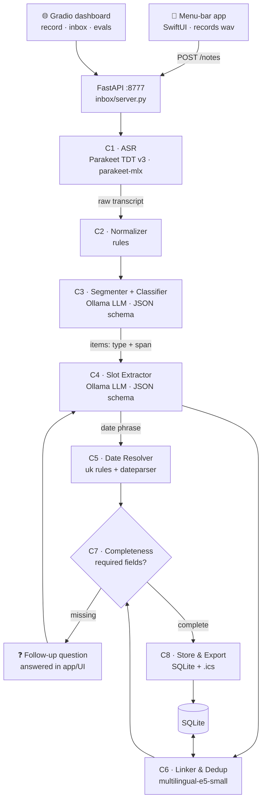

# Голосовий інбокс — Project Plan & Architecture

> A local, free voice-note inbox for Ukrainian, built as a macOS menu-bar app. You say one messy voice note and get
> structured **tasks**, **calendar events** and **tagged notes**. It is an open alternative to
> AudioPen / Todoist Ramble / Mem. Everything runs on the laptop: no paid APIs, and no data leaves the machine.

- **Course:** UCU NLP, Assignment 1: Build an NLP System
- **Working style:** vibecoding. The AI coding agent writes the code; I steer it with `AGENTS.md`, skills, and a check I can run for every step.
- **Hardware:** MacBook, M4 Pro, 24 GB RAM

---

## 1. Scope

### In scope (must ship)
1. Record a voice note from a **macOS menu-bar app** (or the web dashboard).
2. Transcribe it locally with **Parakeet TDT v3** (Ukrainian, with occasional English words mixed in).
3. Split one note into separate **items** (one note often holds 2–4 things).
4. Classify each item: `task` / `event` / `note` / `idea`.
5. Extract the fields: title, date/time phrase, people, project, priority.
6. Turn Ukrainian relative dates ("завтра після обіду", "в наступну п'ятницю") into real datetimes.
7. Link each item to an existing project and flag duplicates of items already stored.
8. Ask a **follow-up question** when a required field is missing (e.g. an event with no day).
9. Save to SQLite; events are also exported as `.ics` files that open in Apple/Google Calendar.
10. **Evaluate every component**, plus one end-to-end score.

### Stretch
- Global hotkey in the menu-bar app ("hold to record").
- Ask questions about past notes, with the source notes cited.
- Telegram bot input; direct Google Calendar sync.

### Out of scope
- Live/streaming transcription, multiple speakers, deployment, paid APIs.

---

## 2. Architecture

### Components

| # | Component | Input → Output | Model / tool | Why |
|---|---|---|---|---|
| C1 | **ASR** | audio → raw text | Parakeet TDT v3 (`parakeet-mlx`, local) | Free, fast on Apple Silicon, supports Ukrainian, proven in TypeWhisper |
| C2 | **Normalizer** | raw → clean text | Python rules | Cheap and deterministic |
| C3 | **Segmenter + Classifier** | text → `[{span, type}]` | Ollama `gemma3:12b`, structured output | Splitting and classifying work best in a single call |
| C4 | **Slot Extractor** | span → fields | Ollama `gemma3:12b`, structured output | Ukrainian free-form phrasing is too varied for rules |
| C5 | **Date Resolver** | phrase + reference time → ISO datetime | Ukrainian rules + `dateparser` | Deterministic and testable; a clear source of errors to report |
| C6 | **Linker & Dedup** | item + stored items → project, duplicate | `multilingual-e5-small` + cosine | Local; the threshold is tuned on labelled pairs |
| C7 | **Completeness** | item → OK / question | Rules per type | Predictable about *when* it asks |
| C8 | **Store & Export** | item → SQLite row, `.ics` | `sqlite3`, `icalendar` | Offline, no OAuth |

**LLM:** local Ollama only (free, private). Default `gemma3:12b`; comparison `qwen3:14b`. You switch between them with
`INBOX_LLM_MODEL`. The model comparison is the report's main "why scores differ" section.

### One input through the system (for the video walkthrough)
1. "Треба купити молоко. І в четвер о третій дзвінок з Вікою по диплому."
2. **C1** produces the raw text, **C2** cleans it.
3. **C3** returns 2 items: `task` "купити молоко" and `event` "в четвер о третій дзвінок з Вікою по диплому".
4. **C4** extracts the event fields: date_phrase = "в четвер о третій", people = [Віка], project hint = "диплом".
5. **C5** resolves "в четвер о третій" relative to the recording time into the next Thursday at 15:00.
6. **C6** links the event to the project "Диплом"; no duplicates found.
7. **C7**: both items complete, so no question is asked.
8. **C8** saves to SQLite, writes an `.ics`, and the menu-bar popover shows both items.

---

## 3. Data

| Set | Size | Source | Used to evaluate |
|---|---|---|---|
| **Scripted set** | 60 notes | LLM-drafted scripts with gold labels, reviewed and **recorded by me** | All components, including ASR |
| **Real-world set** | 20–30 notes | `data/private/typewhisper_uk.jsonl`, hand-labelled | C3–C7 (text only), kept private |
| **Linking pairs** | ~40 | Built from the scripted set | C6 |

Hard cases to cover: several items per note, relative dates, English words mixed into Ukrainian, names and numbers, missing
details, ideas with no action in them. For the report, check SLURP / MASSIVE for Ukrainian coverage before relying on synthetic data.

---

## 4. Evaluation

| Component | Metric |
|---|---|
| C1 ASR | WER, CER, entity WER (names, numbers, dates) |
| C2 Normalizer | WER before vs. after |
| C3 Segmentation / classification | item-count accuracy, item F1; macro-F1 + confusion matrix |
| C4 Slot extraction | per-field exact match + token-F1 |
| C5 Date resolution | exact datetime accuracy by phrase type |
| C6 Linking / dedup | project accuracy; duplicate P/R vs. threshold |
| C7 Clarification | P/R of "asked a question" |
| C8 Store / export | `.ics` + schema validity rate |
| **End-to-end** | % notes with every item fully correct; `gemma3:12b` vs `qwen3:14b` |

For every low score: show 2–3 failure examples, explain why they failed, and say what would fix them.

---

## 5. Build order

| Stage | Work | Done when |
|---|---|---|
| **1** | Environment, `AGENTS.md` + skills, 60 eval scripts, C2–C5 + their evals on text | `eval/run_eval.py --component c3/c4/c5` print metrics |
| **2** | Record 60 notes (~25 min), C1 + eval, C6–C8, pipeline, FastAPI + Gradio, menu-bar app | A note recorded in the menu-bar app shows its items |
| **3** | End-to-end eval, model comparison, real-world check, report, README, video | Report and video ready |

**If something has to go, cut in this order:** global hotkey → qwen comparison → real-world check → dedup → follow-up dialogue in the app.
**Never cut:** per-component evals, the report, the video.
