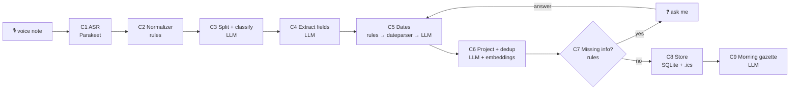

# 🎙️ Голосовий інбокс: a voice notebook that sorts itself

**UCU NLP · Assignment 1 · Build an NLP System** · Oleksandra Ostafiichuk

I already talk instead of typing. I use TypeWhisper for messages and for prompting Claude and agents, because typing
slows me down.

When I need to *slow my mind down*, though, I grab a paper notebook and dump everything into it. Later I sort it into
Notion, my calendar and so on.

This is that notebook, but voice-first. You say one messy Ukrainian note, and it sorts it for you: it gives you
separate **tasks, events, ideas and notes**, with:
- real dates;
- the people mentioned;
- the project each item belongs to;
- a follow-up question when something is missing.

Everything runs locally on a MacBook. There are no paid APIs, and nothing leaves the laptop.

**Contents:**
1. [Task](#1-task)
2. [Data](#2-data)
3. [Components](#3-components)
4. [Prototype and the coding agent](#4-prototype-and-the-coding-agent)
5. [Evaluation](#5-evaluation)
6. [Setup and run](#setup-and-run)

---

## 1. Task

- **User:** me.
  - 412 dictations in two months.
  - One thought-dump usually holds 2–4 different things: *«купити молоко, і в четвер о третій дзвінок з Вікою по
    диплому»*.
  - Writing it down isn't the annoying part. Sorting it afterwards is.
- **What's out there:**
  - AudioPen, Todoist Ramble and Mem are paid, cloud-only, and weak at Ukrainian relative dates
    («в наступну п'ятницю після обіду»).
  - I also really like aesthetic software. The look borrows from Dia's Daily Brief (a paid feature I love), which I ran
    through Claude Design.
- **Useful output:** an item I don't have to edit. Its type, title and date are right, so it can go straight where it
  belongs.
- **Headline metric:** the share of notes where **every** item is fully correct. Target: **≥ 0.6**.

**In scope:**

| In | Out |
|---|---|
| Record a note (Mac menu-bar app with a global ⌃⌥Space hotkey, or the web board) | Streaming / live transcription |
| Ukrainian speech, with English words mixed in | Multiple speakers |
| Split one note into items and type each one: task / event / idea / note | Cloud sync (Google Calendar, Notion) |
| Extract title, date, people, project | Telegram input (next step) |
| Resolve relative dates to exact datetimes | |
| Link items to my 6 projects, flag duplicates | |
| Ask a follow-up question when info is missing | |
| Store items, export events as `.ics` | |
| A morning "gazette": a daily brief built from the inbox | |

This is **not RAG**. It's an extraction pipeline: rules where rules work, an LLM where Ukrainian is too messy for
rules, and a dialogue loop for missing info.

## 2. Data

**First I checked what already exists:**

| Source | What I found | Verdict |
|---|---|---|
| SLURP | spoken commands, English only | ✗ |
| MASSIVE | multilingual, but one intent per sentence; no multi-item notes with relative dates | ✗ |
| My TypeWhisper history | 412 dictations, 96 in Ukrainian, ~46 words each; mostly prompts and messages, and almost none still have audio | private; used only to learn what real notes sound like |

**So I made my own** ([`data/scripted/`](data/scripted)):
- **63 scripted notes, 84 gold items** (43 task, 28 event, 7 idea, 6 note). Each item has a type, title, date phrase,
  exact datetime, people, project and an "incomplete" flag.
- **Hard cases on purpose:**
  - several items per note;
  - «пів на третю», «через два дні»;
  - English words («задеплоїти»);
  - «зустріч з нею» (with *who*?);
  - ideas with no action;
  - duplicates.
- **I recorded 62 of them with my own voice**, so ASR is tested on real speech. The audio is not in the repo.
- **The labels are checked by code** ([`eval/validate_data.py`](eval/validate_data.py)). This caught «понеділок»
  matching «неділ» (Sunday) and «о четвертій» matching «четв» (Thursday).
- **30 held-out date phrases**, written *after* the date rules were done, so the date score is honest.

## 3. Components



| | Purpose | Input → output | Model call | Tool call |
|---|---|---|---|---|
| **C1** ASR | voice → text | audio → raw transcript | Parakeet TDT v3 (0.6B, local, MLX) | `ffmpeg` (decode to 16 kHz) |
| **C2** Normalizer | remove fillers, fix spacing | raw → clean text | none | none |
| **C3** Segment + classify | one note → separate items, each with a type | text → `[{span, type}]` | gemma3:12b (Ollama, JSON schema) | none |
| **C4** Slot extractor | pull out the fields | span + note → title, date phrase, people, project hint, priority, "unresolved person" | gemma3:12b (JSON schema) | none |
| **C5** Date resolver | «в четвер о третій» → exact time | phrase + recording time → ISO datetime | gemma3 **only as a fallback** | Ukrainian rules, then `dateparser` |
| **C6** Linker + dedup | which project? already stored? | item + projects + stored items → project, duplicate id | gemma3 picks from an enum of projects; `multilingual-e5-small` embeddings for dedup | SQLite read |
| **C7** Completeness | do I need to ask? | item → OK or a Ukrainian question | none | none |
| **C8** Store + export | save it, make it calendar-ready | item → SQLite row + `.ics` file | none | `sqlite3`, `icalendar` |
| **C9** Daily gazette | morning brief from my inbox | stored items + today → headline, agenda, project notes, plan | gemma3:12b; it may cite items only by id | SQLite read |

**Why this split:**
- **Deterministic first.** Dates and "should I ask?" must be exact and predictable, so they're rules. The LLM only
  handles what's too varied for rules.
- **C3 does splitting and typing in one call,** because they depend on each other.
- **C6 dropped embeddings for projects.** Every item scored 0.82–0.86 against every project, so no threshold worked.
- **Every LLM call goes through one module,** [`inbox/llm.py`](inbox/llm.py). It uses the output schema, temperature 0
  and 1 retry, and logs every call to `logs/llm_trace.jsonl`. The prompts live in [`inbox/prompts/`](inbox/prompts).

**One input through the system:**

> «Треба купити молоко. І в четвер о третій дзвінок з Вікою по диплому.»

1. **C1/C2:** audio → clean text, in ~0.2 s.
2. **C3:** two items, `task` «купити молоко» and `event` «в четвер о третій дзвінок з Вікою по диплому».
3. **C4:** for the event, the date phrase is «в четвер о третій», people are [Віка], and the project hint is «диплом».
4. **C5:** next Thursday, 15:00. The rule is "hours 1–7 mean PM".
5. **C6:** the event goes to «Диплом» and the milk to «Дім»; no duplicates.
6. **C7:** both items are complete, so no question.
   *(Say «скинути йому презентацію» instead, and it asks «Кого саме стосується…?».)*
7. **C8:** both items are saved; the event gets an `.ics` file. Both cards appear on the board.
8. **C9:** tomorrow's gazette puts the call on the agenda.

## 4. Prototype and the coding agent

**The prototype:**
- **Backend:** FastAPI, [`inbox/server.py`](inbox/server.py).
- **Web board:** [`inbox/web/`](inbox/web).
  - Record or type a note.
  - See each note's live status (transcribing → splitting → saving).
  - Cards are grouped by type, project, date or status. Drag a card to change it.
  - Answer follow-up questions right on the card.
  - `/gazette` is the morning brief. `/architecture` is the pipeline on one screen.
- **SwiftUI menu-bar app:** [`macapp/`](macapp). It records from any app with ⌃⌥Space.

**How I steered the coding agent** (Claude Code):
- **[`AGENTS.md`](AGENTS.md):** the rulebook the agent reads every session.
  - **Process:** work in CRISP-DM phases and log every decision, including abandoned ideas, in
    [`report/crisp_dm_log.md`](report/crisp_dm_log.md).
  - **Architecture:** one module per component, typed I/O, prompts in files, LLM calls only through `llm.py`,
    deterministic first.
  - **"No component without an eval."**
  - **Privacy:** never commit or quote my private notes.
  - **Definition of done:** every step ends with one command I can run that prints a clear result.
- **[`CLAUDE.md`](CLAUDE.md):** loads `AGENTS.md` and [`PLAN.md`](PLAN.md) into context automatically.
- **[`.claude/skills/`](.claude/skills):** repeatable procedures, so I don't re-explain them in prompts.
  - `add-component`: module + schema + eval stub + log entry.
  - `eval-component`: run an eval and write the failure analysis.
  - `make-eval-data`: build gold notes against a hard-case checklist.
  - `crisp-dm-log`: add a decision to the right phase.

**Reflection:** the agent builds something *plausible* very fast. These files are what made it *measurable*.
- The evals caught an over-optimistic date score, which is why the held-out set exists.
- They also showed that two models with the same final score fail in completely different places.

## 5. Evaluation

Every component has its own eval. Run one with `uv run python eval/run_eval.py --component <id>`. The results are in
[`eval/results/`](eval/results): `<id>.md` has the table plus the worst examples, and `<id>.json` has the raw output.

Everything after C1 is scored on **gold text**, so ASR errors don't leak into the other numbers. End-to-end is scored
on both text and my real audio.

### Why these metrics

| | Metric | Why this one |
|---|---|---|
| C1 | WER, CER, recall of names and date words | WER is standard, but a wrong name or date hurts more than a wrong filler, so I track those separately |
| C2 | WER before vs. after | does cleaning help or hurt? |
| C3 | item-count accuracy, segmentation F1, type macro-F1 | macro, because the classes are imbalanced (43 tasks vs. 7 ideas) |
| C4 | title token-F1, date-phrase token-F1, people set-F1 | titles are paraphrased, so exact match is too harsh |
| C5 | **exact** datetime accuracy, plus a held-out set | one hour off is simply wrong; the held-out set catches overfitting |
| C6 | project accuracy; dedup P/R across thresholds | the threshold sweep shows *why* embeddings fail |
| C7 | precision / recall of "asked a question" | the trade-off between annoying me and missing info |
| C8 | round-trip exactness, valid `.ics` | it's storage, so it should be perfect |
| C9 | invented item ids, done items in the agenda, coverage of today's tasks | the risk with a generated brief is made-up tasks |
| E2E | % of notes where every item is fully correct | the business metric: no edits needed |

### Results (gemma3:12b)

| | Score |
|---|---|
| C1 ASR | WER **0.18** · CER 0.10 · names / date words 0.76 · 0.2 s per note |
| C2 Normalizer | WER 0.182 → 0.184 (no gain) |
| C3 Split + type | item count **0.97** · segmentation F1 0.96 · type macro-F1 **0.98** |
| C4 Fields | title **0.96** · date phrase 0.94 · people 0.91 |
| C5 Dates | gold **0.98** · held-out **0.90** (rules) → 0.93 (+ LLM) |
| C6 Project / dedup | embeddings 0.60 → **LLM 0.80** · dedup F1 0.80 |
| C7 Ask | precision **1.00** · recall 0.88 |
| C8 Store | 100% round-trip · 44/44 valid `.ics` |
| C9 Gazette | invented ids **0** · done items in the agenda 0 · today's tasks covered 0.92 |
| **E2E from text** | **0.60** of notes fully correct ✅ |
| **E2E from my voice** | **0.51** |

### gemma3:12b vs qwen3:14b

The prompts and data are identical; only the model changes.

| | gemma | qwen |
|---|---|---|
| E2E notes fully correct | 0.60 | 0.60 |
| Project choice | 0.80 | **0.87** |
| People F1 | **0.91** | 0.83 |
| Asks when info is missing | **0.88** | 0.50 |
| Split speed | 3.9 s | **2.9 s** |

They tie overall but fail in different places:
- **qwen** is better at picking from a list.
- **gemma** is better at Ukrainian names.
- **qwen almost never flags «йому / їй» as unknown,** so it skips half of the needed questions.

**I kept gemma.** A wrong project I see and fix in a second. A task «send *him* the slides» saved with no name I never
notice.

### Why the scores aren't higher, and what would fix them

| Problem | Example | Fix |
|---|---|---|
| **Voice costs ~10 points end-to-end:** one early ASR error breaks every later step | «в четвер **о** третій» → «в четвер-третій», so the call merged into the shopping task | hotwords for my vocabulary, or a Ukrainian fine-tune |
| ASR mangles English words; Russian numerals | «бекенд» → «бакет», «NLP» → «Нолпі», «семь» | same as above |
| WER over-counts | «1 грудня о 9-й» vs «Першого грудня о дев'ятій»: same meaning | WER on normalised text (digits ↔ words) |
| C2 doesn't help | Parakeet output is already clean | keep it only for fillers, or drop it |
| C5 gold vs. held-out gap | «через пів години», «на вихідних», «третього числа» | more rules. I didn't add them, so the held-out set stays honest. |
| C6 leftovers are mostly *my* labels | «подарунок мамі»: is that Дім or no project? | a clearer labelling convention |
| C7 misses one case | «зустріч з ними перенести» got typed as a task, and the rule only asks about events | ask for tasks too. I kept precision at 1.0, because a pointless question is worse. |
| Strict title metric | «Закинути гроші на телефон» vs «Поповнити телефон» counts as wrong | a semantic or LLM-judge title metric |

---

## Setup and run

You need macOS on Apple Silicon.

```bash
brew install uv ffmpeg ollama
uv sync
ollama pull gemma3:12b            # optional: qwen3:14b for the comparison

uv run inbox-server               # → http://127.0.0.1:8777
./macapp/build.sh && open macapp/build/VoiceInbox.app   # menu-bar app, ⌃⌥Space from anywhere
```

Evaluation:

```bash
uv run python -m eval.validate_data          # check the gold labels
uv run pytest -q                             # unit tests for the Ukrainian date rules
uv run python eval/run_eval.py --all         # every component → eval/results/
INBOX_LLM_MODEL=qwen3:14b uv run python eval/run_eval.py --component e2e_text
```

LLM tracing: `tail -f logs/llm_trace.jsonl` shows every model call (prompt, latency, tokens) live.

**Privacy:** my real notes, my voice recordings and the database are git-ignored. Nothing talks to anything outside
`localhost`.
